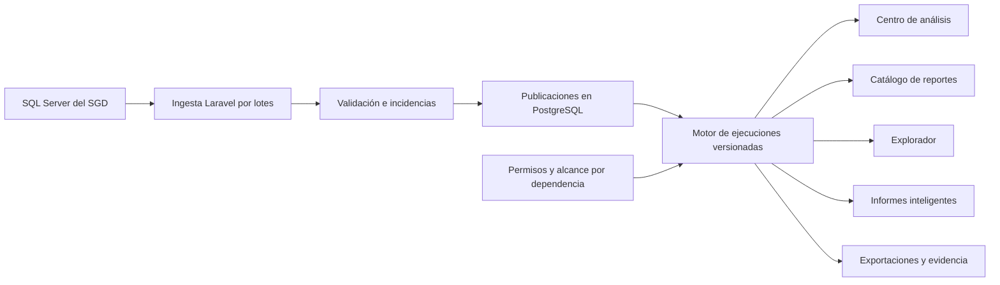

# SIRMD — mapa de información del proyecto

Plataforma integral de reportes, análisis e inteligencia documental de la Municipalidad Distrital de San Jerónimo, independiente del SGD.

La organización inicial comprende cuatro áreas: **Centro de análisis**, **Catálogo de reportes**, **Explorador de datos** e **Informes inteligentes**. Los pendientes por dependencia serán uno de los reportes del catálogo. Ningún reporte debe determinar la arquitectura global o dominar la interfaz; la organización puede evolucionar durante el proyecto.

Este README es el punto de entrada para construir el sistema: relaciona requisitos, reglas, datos, diseño, código existente y verificaciones. Los documentos enlazados conservan el detalle. **Mapa revisado el 15 de octubre de 2026 (America/Lima)** a partir de la documentación local; esta revisión no vuelve a consultar las bases de datos ni certifica su estado actual.

## Navegación

- [Estado documentado](#estado-documentado)
- [Qué consultar para construir cada capacidad](#qué-consultar-para-construir-cada-capacidad)
- [Inventario de documentos](#inventario-de-documentos)
- [Cómo resolver diferencias entre documentos](#cómo-resolver-diferencias-entre-documentos)
- [Mapa de datos y arquitectura](#mapa-de-datos-y-arquitectura)
- [Reglas del primer reporte](#reglas-del-primer-reporte)
- [Evidencia disponible y sus límites](#evidencia-disponible-y-sus-límites)
- [Orden de construcción y decisiones pendientes](#orden-de-construcción-y-decisiones-pendientes)
- [Mapa del código existente](#mapa-del-código-existente)
- [Base técnica](#base-técnica), [ejecución](#ejecutar-el-proyecto), [PostgreSQL](#postgresql-y-acceso), [login](#primera-cuenta-e-inicio-de-sesión), [SGD](#conexión-del-sgd) y [verificación](#verificación)

## Estado documentado

| Componente | Estado | Dónde comprobar el alcance |
|---|---|---|
| Aplicación Laravel, presentación y cuatro áreas | Implementado el arranque; las áreas son pantallas conceptuales | [Login: presentación y flujo](docs/implementacion/03-login.md#presentación) |
| PostgreSQL propio | Conexión y tablas iniciales de acceso documentadas como aplicadas | [Acceso](docs/implementacion/01-acceso-modelos.md) |
| Usuarios, roles y permisos | Modelos, cinco migraciones de acceso, tres roles y quince permisos implementados | [Datos iniciales](docs/implementacion/01-acceso-modelos.md#datos-iniciales) |
| Login por DNI, logout y protección de rutas | Implementados; existe comando para crear la primera cuenta | [Acceso web](docs/implementacion/03-login.md) |
| Cuenta web real | La última entrega indica que no creó cuentas reales; verificar en la instalación al usarla | [Primera cuenta](docs/implementacion/03-login.md#crear-la-primera-cuenta) |
| Conexión SQL Server del SGD | Driver y comando de diagnóstico implementados; lectura de siete objetos verificada el 14/10 | [Resultado real](docs/implementacion/02-conexion-sgd.md#resultado-real) |
| Ingesta, publicaciones y datos documentales locales | Diseñados, pendientes de implementación | [Modelo, §§5–6](docs/modelo-entidad-relacion.md#5-fuentes-ingesta-y-publicaciones) |
| Alcance por dependencia y auditoría funcional | Diseñados; los permisos de capacidades actuales no sustituyen el filtro de oficinas | [Modelo, §4](docs/modelo-entidad-relacion.md#4-usuarios-roles-y-alcance-de-datos) |
| Reportes, indicadores, filtros de datos y exportaciones | Pendientes | [Modelo, §§7–8](docs/modelo-entidad-relacion.md#7-definiciones-y-motor-común-de-análisis) |
| Informes inteligentes e IA | Ampliación propuesta; sin servicio Python ni SDK de IA instalado según la documentación | [Modelo, §9](docs/modelo-entidad-relacion.md#9-informes-inteligentes-ampliaciones-previstas) |
| Cola persistente y workers | Pendientes; `QUEUE_CONNECTION=sync` ejecuta en el proceso actual | [Viabilidad: procesamiento](docs/viabilidad-tecnologica.md#cómo-procesar-los-datos-con-php) |

## Qué consultar para construir cada capacidad

| Voy a construir o revisar… | Información que necesito | Lectura directa |
|---|---|---|
| Alcance y navegación global | Propósito de las cuatro áreas y límites del primer reporte | [Consolidado, §0](docs/propuesta-consolidada.md#0-visión-de-la-plataforma) |
| Usuarios y autorización | Campos, relaciones, roles, Gates, revocaciones y asignaciones iniciales | [Acceso: usuarios y permisos](docs/implementacion/01-acceso-modelos.md) |
| Autenticación e interfaz común | Rutas, sesión, CSRF, límite de intentos, creación administrativa y componentes Blade | [Login](docs/implementacion/03-login.md) |
| Permisos documentales | Oficinas autorizadas, nombres/asuntos, descargas y auditoría | [Modelo, §4](docs/modelo-entidad-relacion.md#4-usuarios-roles-y-alcance-de-datos) y [§7.2](docs/modelo-entidad-relacion.md#72-ejecuciones-y-archivos) |
| Conexión al origen | Separación `pgsql`/`sgd`, variables, driver, permisos efectivos y diagnóstico | [Conexión SGD](docs/implementacion/02-conexion-sgd.md) |
| Migraciones de integración | Fuentes, ingestas, publicaciones, incidencias y pertenencia a una misma fuente | [Modelo, §5](docs/modelo-entidad-relacion.md#5-fuentes-ingesta-y-publicaciones) y [§10](docs/modelo-entidad-relacion.md#10-integridad-que-deben-garantizar-las-migraciones) |
| Extracción y sincronización | Lotes, claves compuestas, consistencia, cambios, eliminaciones y publicación atómica | [Consumo de datos](docs/implementacion/02-conexion-sgd.md#cómo-se-consumirán-los-datos), [viabilidad](docs/viabilidad-tecnologica.md#cómo-procesar-los-datos-con-php) |
| Tablas documentales y catálogos | Campos fuente, identidades estables, capturas, referencias y restricciones | [Modelo fuente](docs/fase-1/04-modelo-datos.md), [modelo de plataforma, §6](docs/modelo-entidad-relacion.md#6-modelo-documental-compartido) |
| Conciliación con el SGD | Recorrido pantalla→DAO, acceso total/personal, SQL y diferencias contador/listado | [Flujos](docs/fase-1/02-flujos-bandejas.md), [reglas](docs/fase-1/03-diccionario-reglas.md), [SQL](docs/fase-1/sql/README.md) |
| Pendientes por dependencia | Perfiles, unidad, filtros, prioridad, antigüedad y salidas del MVP | [Consolidado, §§3–6](docs/propuesta-consolidada.md#3-hallazgos-que-cambian-la-implementación), [modelo, §11](docs/modelo-entidad-relacion.md#11-reglas-particulares-del-primer-reporte) |
| Motor común y catálogo | Contratos, ejecutores registrados, versiones, contexto de ejecución y artefactos | [Modelo, §7](docs/modelo-entidad-relacion.md#7-definiciones-y-motor-común-de-análisis) |
| Excel/CSV y archivos | Misma ejecución que el detalle, almacenamiento privado y permisos al descargar | [Modelo, §7.2](docs/modelo-entidad-relacion.md#72-ejecuciones-y-archivos), [alcance MVP](docs/propuesta-consolidada.md#6-alcance-del-primer-reporte-especializado) |
| Centro de análisis | Indicadores versionados, tableros y publicaciones compartidas por vista | [Modelo, §8](docs/modelo-entidad-relacion.md#8-centro-de-análisis-y-explorador-ampliaciones-previstas) |
| Explorador | Campos/filtros permitidos, consultas guardadas, versiones y alcance al ejecutar | [Modelo, §8](docs/modelo-entidad-relacion.md#8-centro-de-análisis-y-explorador-ampliaciones-previstas) |
| Informes periódicos e IA | Plantillas, programación, evidencias, idempotencia, borradores y aprobación humana | [Modelo, §9](docs/modelo-entidad-relacion.md#9-informes-inteligentes-ampliaciones-previstas), [viabilidad IA](docs/viabilidad-tecnologica.md#ia-y-posibles-componentes-python) |
| Productividad, movimientos, tiempos y alertas | Casos futuros y necesidad de comprobar eventos y fechas antes de calcular | [Propuesta inicial, §6](docs/propuesta_reporteador_inteligente_sgd.md#6-módulos-funcionales), [límites actuales](docs/modelo-entidad-relacion.md#11-reglas-particulares-del-primer-reporte) |
| Rendimiento, históricos y retención | Índices, crecimiento de capturas, mediciones y archivo de evidencia | [Modelo, §12](docs/modelo-entidad-relacion.md#12-índices-volumen-y-retención), [plan de medición](docs/viabilidad-tecnologica.md#validación-antes-de-confirmar-el-rendimiento) |
| Pruebas y aceptación del primer reporte | Casos límite, comparación por claves y cifras, cobertura del piloto | [Validaciones](docs/fase-1/05-validaciones.md), [contraste realizado](docs/propuesta-consolidada.md#11-hallazgos-del-contraste-con-datos-de-producción) |

## Inventario de documentos

Se revisaron los **18 Markdown de documentación del proyecto**, incluido este README, y las dos notas locales de memoria de `.claude/`. Los Markdown de `laravel/vendor/` pertenecen a dependencias de terceros y quedan fuera del mapa del proyecto.

| Documento | Contenido y uso | Carácter |
|---|---|---|
| [README principal](README.md) | Mapa de consulta, estado, decisiones y operación local | Índice central |
| [Propuesta consolidada](docs/propuesta-consolidada.md) | Visión, hallazgos, perfiles, alcance, contraste de producción y avances | Síntesis funcional; algunas notas de avance quedaron desactualizadas |
| [Modelo entidad-relación](docs/modelo-entidad-relacion.md) | Entidades, campos, diagramas, integridad, índices y etapas A–E | Diseño actual; solo acceso está implementado |
| [Viabilidad tecnológica](docs/viabilidad-tecnologica.md) | Responsabilidades de PHP/PostgreSQL, lotes, colas, IA y criterios para Python | Decisión de arquitectura; sin prueba de carga |
| [Propuesta inicial](docs/propuesta_reporteador_inteligente_sgd.md) | Problema, objetivos, módulos, reportes futuros, hoja de ruta y plan de investigación | Antecedente y catálogo de necesidades futuras |
| [Documentación del reporteador anterior](docs/DOCUMENTACION_SGD_REPORTES.md) | Diccionario, consultas Python/SQL, pendientes por oficina/empleado, vencidos, dashboard y filtros | Antecedente; sus reglas difieren del SGD investigado y contiene credenciales que no se trasladan a este índice |
| [Fase 1 · Inventario](docs/fase-1/01-inventario.md) | Archivos, hashes, componentes, método `javap` y límites del análisis | Evidencia estática |
| [Fase 1 · Flujos](docs/fase-1/02-flujos-bandejas.md) | Vista, JavaScript, controlador, servicio, DAO, contexto de sesión y listado | Evidencia estática |
| [Fase 1 · Diccionario de reglas](docs/fase-1/03-diccionario-reglas.md) | R01–R12, acceso personal, referencias, prioridades y diferencias legacy | Reglas observadas en código; completar con el contraste posterior |
| [Fase 1 · Modelo fuente](docs/fase-1/04-modelo-datos.md) | Tablas/campos mínimos, relaciones deducidas y verificaciones de metadatos | Base de investigación del origen |
| [Fase 1 · Validaciones](docs/fase-1/05-validaciones.md) | Protocolo, casos límite, evidencias a registrar y criterio de aceptación | Plan reutilizable; su estado precede al contraste de producción |
| [Fase 1 · Modelo analítico](docs/fase-1/06-modelo-analitico-propuesto.md) | Primer diseño de sincronización, cortes y perfiles del MVP | Antecedente ampliado por el modelo de plataforma |
| [Fase 1 · Índice SQL](docs/fase-1/sql/README.md) | Siete consultas, naturaleza, parámetros y restricciones de uso | Herramientas de contraste, no ingesta implementada |
| [Implementación · Acceso](docs/implementacion/01-acceso-modelos.md) | Usuarios, permisos, seeders, migraciones y pruebas | Entrega implementada |
| [Implementación · Conexión SGD](docs/implementacion/02-conexion-sgd.md) | Driver, configuración, diagnóstico, resultado real y futura ingesta | Conexión implementada; cierre sobre login desactualizado |
| [Implementación · Login](docs/implementacion/03-login.md) | Primera cuenta, autenticación, autorizaciones vigentes, interfaz y pruebas | Entrega implementada de referencia para acceso web |
| [Aplicación Laravel](laravel/README.md) | Entrada al directorio de aplicación y enlaces operativos | Guía breve |
| [Migraciones de infraestructura](laravel/database/migrations/infraestructura/README.md) | Activación futura de tablas para sesiones, caché y cola | Infraestructura pendiente |

Las notas locales [MEMORY.md](.claude/projects/c--Users-PracticanteOTI-Desktop-REPORTE-SGD/memory/MEMORY.md) y [conexion-sgd-bd.md](.claude/projects/c--Users-PracticanteOTI-Desktop-REPORTE-SGD/memory/conexion-sgd-bd.md) recuerdan el primer contraste y su contexto. Sus hallazgos están incorporados al consolidado, §11; no son requisitos adicionales ni instrucciones de despliegue. Pueden no acompañar una copia distribuida del proyecto.

## Cómo resolver diferencias entre documentos

Consultar la evidencia específica de cada tema, distinguiendo **implementado**, **diseñado**, **observado en código** y **contrastado en una fecha**. La propuesta de una tabla o función no acredita que ya exista en la aplicación.

| Diferencia encontrada | Referencia que corresponde usar al construir |
|---|---|
| Consolidado §§14–15 y cierre de conexión indican login pendiente | [Implementación 03](docs/implementacion/03-login.md): login y protección de rutas ya implementados |
| Documentos de fase 1 dicen que no hubo consultas ni validación numérica | Conservan el estado de la revisión estática; [consolidado §11](docs/propuesta-consolidada.md#11-hallazgos-del-contraste-con-datos-de-producción) registra el contraste posterior del 13/10 |
| Fase 1 propone `fuentes_sgd`, `ejecuciones_sync` y `cortes` | Para nuevas migraciones seguir el [modelo de plataforma](docs/modelo-entidad-relacion.md): fuentes, ingestas, publicaciones y capturas compartidas |
| Propuesta inicial enumera cuatro perfiles de usuario | El [catálogo implementado](docs/implementacion/01-acceso-modelos.md#datos-iniciales) tiene tres roles y quince permisos; jefe/consultor no son roles adicionales ya creados |
| Consultas antiguas incluyen observado, otra regla de referencia y vencimientos | Usar [reglas comparadas](docs/fase-1/03-diccionario-reglas.md) y decisiones del consolidado; vencimientos están fuera del MVP |
| Propuesta menciona autenticación/frontend por decidir | DNI/contraseña y Blade/Vite/Tailwind ya están elegidos; gráficos, hospedaje y SSO siguen pendientes |
| Documentos antiguos afirman ausencia de credenciales en el repositorio | El antecedente de reportes y la memoria local contienen información sensible; la configuración vigente se consulta sin copiar secretos al README |

## Mapa de datos y arquitectura

Flujo previsto; actualmente están implementados el acceso web, la base de acceso y la conexión de diagnóstico al SGD:



| Dato necesario | Fuente SGD y claves/campos | Destino propuesto en PostgreSQL |
|---|---|---|
| Documento emitido | `TDTV_REMITOS`: `(NU_ANN, NU_EMI)`, estado, eliminación, tipo, emisor, emisión y plazo | `documentos_captura` |
| Asignación/destino | `TDTV_DESTINOS`: `(NU_ANN, NU_EMI, NU_DES)`, `TI_DES`, dependencia, destinatario, receptor, recepción y prioridad | `destinos_captura` |
| Oficina y encargado | `RHTM_DEPENDENCIA`: `CO_DEPENDENCIA`, `CO_EMPLEADO`, nombre y baja | `dependencias` + `dependencias_captura` |
| Empleado | `RHTM_PER_EMPLEADOS`: `CEMP_CODEMP`, datos mínimos autorizados y dependencia | `empleados` + `empleados_captura`; independiente de `users` |
| Relación de respuesta | `TDTR_REFERENCIA`: claves de respuesta y referencia, destino opcional; PK fuente por revisar | `referencias_captura`, conservando claves originales |
| Tipo documental | `SI_MAE_TIPO_DOC`: `CDOC_TIPDOC`, descripción | `tipos_documentales_captura` |
| Estados | `TDTR_ESTADOS`: código, descripción y dominio de emisión/recepción | `estados_captura`, separando ambos dominios |
| Prioridad | `TDTV_DESTINOS.CO_PRI`; códigos `1/2/3` observados en SQL y UI | `prioridades_captura` y código original en destino |
| Resumen del listado legacy | `TDTX_REMITOS_RESUMEN`: `(NU_ANN, NU_EMI)` | Evidencia para explicar el listado; no requisito de existencia para contar pendientes |

Campos y comprobaciones: [modelo fuente](docs/fase-1/04-modelo-datos.md). Identidades, columnas, cardinalidades y restricciones locales: [modelo de plataforma, §§3–6 y 10](docs/modelo-entidad-relacion.md#3-convenciones). Los tipos y longitudes definitivos dependen del DDL; los identificadores se conservan como texto con ceros iniciales.

Cada publicación debe conservar su contexto de catálogos y pertenecer a una fuente. Una ejecución fija publicaciones, filtros, alcance autorizado, perfil y versión de implementación. Resumen, gráfico, detalle y exportación reutilizan ese contexto. Las incidencias críticas impiden publicar; un fallo mantiene disponible la última publicación válida y su fecha.

## Reglas del primer reporte

El primer reporte será `pendientes_dependencia`. Estas reglas no definen por sí solas los demás reportes de la plataforma.

| Tema | Regla de construcción | Fuente |
|---|---|---|
| Unidad | Contar destinos como asignaciones; deduplicar documentos por `(fuente, año, emisión)` dentro del ámbito. No sumar documentos únicos de distintas oficinas | [Modelo, §11](docs/modelo-entidad-relacion.md#11-reglas-particulares-del-primer-reporte) |
| Universo interno | `TI_DES='01'`; destinos externos no son pendientes de oficina ni incidencias por carecer de empleado interno | [Consolidado, §11.2](docs/propuesta-consolidada.md#112-la-incidencia-sin-clasificar-explicada-tipo-de-destino) |
| Perfil institucional | Recepción `0/1`, destino activo, emisión fuera de `5/7/9/8`, referencia exacta excluyente, clasificación por encargado y suma de prioridades `1/2/3`; sin filtro de eliminación de cabecera | [R01–R12](docs/fase-1/03-diccionario-reglas.md#regla-institucional-observada-tiacceso0) |
| Perfil analítico | Propuesto: remito y destino activos, recepción `0/1`, emisión fuera de `5/7/9/8`; conserva referencias como atributo, todas las prioridades y responsables | [Dos perfiles](docs/fase-1/06-modelo-analitico-propuesto.md#dos-perfiles-explícitos); requiere aceptación funcional |
| Entrada/delegados | En acceso total: destinatario igual/distinto del encargado capturado. No acredita delegación formal. Acceso personal tiene reglas diferentes y muestra no leídos/recibidos | [Flujos](docs/fase-1/02-flujos-bandejas.md#carga-de-contadores) |
| Prioridades | Azul normal `1`, naranja urgente `2`, rojo muy urgente `3`; urgentes son subconjunto, no sumando adicional ni señal de vencimiento | [Consolidado, §3.3](docs/propuesta-consolidada.md#33-los-colores-representan-prioridad) |
| Referencias | Una respuesta referenciada no prueba atención concluida; evitar multiplicar destinos al unir varias referencias | [Modelo, §6.2](docs/modelo-entidad-relacion.md#62-documentos-destinos-y-referencias) |
| Antigüedad | Recepción o emisión sustituta identificada; fecha de cálculo explícita; tramos 0–3, 4–7, 8–15, 16–30 y más de 30 días; fechas futuras como incidencia | [Modelo, §11](docs/modelo-entidad-relacion.md#11-reglas-particulares-del-primer-reporte) |
| Plazos | Fuera del MVP: cobertura documentada 18 de 11.200 (0,16%). Sin plazo no significa en plazo | [Consolidado, §5](docs/propuesta-consolidada.md#5-definiciones-del-reporteador) |
| Históricos | Capturas desde la primera ingesta validada; filtrar emisión antigua sobre estados actuales no reconstruye saldos pasados | [Consolidado, §5](docs/propuesta-consolidada.md#5-definiciones-del-reporteador) |
| Estados y catálogos | Separar emisión/recepción; no agrupar archivado, derivado y enviado como atendido. Un catálogo faltante no debe eliminar el destino | [Reglas](docs/fase-1/03-diccionario-reglas.md), [modelo, §6](docs/modelo-entidad-relacion.md#6-modelo-documental-compartido) |
| Presentación y salidas | Oficinas con saldo cero, filtros explícitos, alcance autorizado, actualización, perfil y versión visibles; mismo conjunto para resumen, gráfico, detalle y Excel/CSV | [Alcance MVP](docs/propuesta-consolidada.md#6-alcance-del-primer-reporte-especializado) |

## Evidencia disponible y sus límites

| Evidencia | Qué permite afirmar | Qué falta |
|---|---|---|
| [Inventario CSV](docs/fase-1/evidencia/inventario.csv) y [resumen con hashes](docs/fase-1/evidencia/resumen-inventario.json) | Copia local de 738 archivos; inspección de vistas, scripts y seis clases; contenido del origen sin cambios durante la exploración | Confirmar correspondencia con el artefacto desplegado |
| [Flujo y SQL extraído](docs/fase-1/sql/README.md) | Reglas observadas en bytecode para acceso total/personal y diferencias con listado | Conciliación amplia de claves, listado paginado y acceso personal |
| [Contraste del 13/10/2026](docs/propuesta-consolidada.md#11-hallazgos-del-contraste-con-datos-de-producción) | Aproximadamente 252 mil remitos, 295 mil destinos y 155 dependencias; sin duplicados de claves documentados; coincidencia de contadores para `00021` | No demuestra cifras actuales ni validación de todas las oficinas; el contraste usó `READ UNCOMMITTED` |
| [Diagnóstico del 14/10/2026](docs/implementacion/02-conexion-sgd.md#resultado-real) | Conexión a `IDOSGD_MDSJ`, esquema `IDOSGD`, y lectura de siete objetos | No valida una extracción completa, DDL definitivo, incrementalidad o consistencia |
| Pruebas descritas en [acceso](docs/implementacion/01-acceso-modelos.md#verificación) y [login](docs/implementacion/03-login.md#verificación) | Cobertura de identidad, relaciones, autorización, sesiones y primera cuenta | No acredita funcionamiento de reportes todavía no construidos |

Referencia histórica para Abastecimiento (`00021`), **13 de octubre de 2026**, perfil institucional:

| Bandeja | No leídos | Recibidos sin atender | Total de asignaciones |
|---|---:|---:|---:|
| Entrada | 43 | 16 | 59 |
| Delegados | 304 | 299 | 603 |

Estas cifras sirven para entender la conciliación documentada, no como valores esperados permanentes de una base operativa. El piloto debe registrar fecha, contexto, parámetros, claves y causas de diferencias según el [protocolo de contraste](docs/fase-1/05-validaciones.md#protocolo-de-contraste).

El [índice SQL](docs/fase-1/sql/README.md) separa originales `01–04`, reconstrucciones institucionales `05–06` y metadatos/calidad `07`. Los marcadores `:pCoDep`/`:pCoEmp` requieren vinculación de parámetros; los originales conservan `NOLOCK` como evidencia. No representan una política aprobada de ingesta ni implementan el perfil analítico. La [herramienta de exploración](herramientas-analisis/explorar_sgd.py) regenera el inventario y los cuatro SQL originales; no es un servicio productivo.

## Orden de construcción y decisiones pendientes

La secuencia A–E del [modelo, §13](docs/modelo-entidad-relacion.md#13-orden-de-construcción) organiza la implementación. Las fases 1–5 de la propuesta inicial son una hoja de ruta funcional anterior; no son otra lista de migraciones.

| Etapa | Trabajo y dependencia | Resultado que permite avanzar |
|---|---|---|
| A · Completar integración | Acceso ya implementado; crear fuentes, ingestas, publicaciones e incidencias | Trazabilidad y publicación coherente, aún sin reportes reales |
| B · Datos documentales | Contrastar DDL; crear identidades, catálogos y capturas; añadir alcance por oficina | Publicación sintética validada; después, primer lote real bajo las condiciones de integración |
| C · Motor y primer reporte | Contratos, perfiles, ejecutores, versiones, ejecuciones y artefactos sobre publicaciones | Pendientes por dependencia con igualdad entre resumen, detalle y exportación |
| D · Análisis y explorador | Reutilizar motor y permisos; definir indicadores y consultas concretos | Tableros y consultas guardadas con alcance vigente |
| E · Informes inteligentes | Reutilizar ejecuciones verificadas; elegir plantillas, proveedor y formatos | Borradores reproducibles con aprobación humana |

| Decisión o información pendiente | Cuándo se necesita | Documento de trabajo |
|---|---|---|
| Cuenta SQL con permisos efectivos de lectura y condiciones TLS del despliegue | Antes de automatizar extracción | [Conexión: configuración](docs/implementacion/02-conexion-sgd.md#configuración) |
| DDL: tipos, longitudes, nulabilidad, índices, PK de referencias y dominios de estado | Antes de fijar migraciones y contratos de extracción | [Verificaciones fuente](docs/fase-1/04-modelo-datos.md#verificaciones-previas-a-la-integración) |
| Lectura consistente, lotes, marcas de cambio y eliminaciones | Antes de implementar ingesta real; `FE_EMI` no basta para detectar actualizaciones | [Consumo de datos](docs/implementacion/02-conexion-sgd.md#cómo-se-consumirán-los-datos) |
| Frecuencia, retención, almacenamiento y metas de rendimiento | Antes de automatizar capturas; 30 publicaciones completas supondrían ~16,4 millones de filas de documentos/destinos | [Modelo, §12](docs/modelo-entidad-relacion.md#12-índices-volumen-y-retención) |
| Aprobación del perfil analítico y tratamiento de excepciones | Antes de publicar ese perfil institucionalmente | [Consolidado, §9](docs/propuesta-consolidada.md#9-condiciones-de-aceptación-y-pendientes) |
| Campos sensibles visibles/exportables y asignación de oficinas | Antes de habilitar datos documentales y descargas | [Modelo, §4](docs/modelo-entidad-relacion.md#4-usuarios-roles-y-alcance-de-datos) |
| Piloto en al menos dos oficinas, acceso personal y listado | Antes de declarar conciliación suficiente para publicación institucional | [Validaciones](docs/fase-1/05-validaciones.md) |
| Cola persistente, workers y almacenamiento compartido del limitador si hay varias instancias | Antes de trabajos largos o despliegue distribuido | [Infraestructura](laravel/database/migrations/infraestructura/README.md), [login](docs/implementacion/03-login.md#flujo-y-autorización) |
| Eventos de movimientos, atenciones y delegaciones formales; reglas de plazo | Antes de productividad, tiempos, trazabilidad o vencimientos | [Modelo, §§11 y 14](docs/modelo-entidad-relacion.md#14-decisiones-que-se-mantienen-abiertas) |
| Gráficos, bibliotecas de exportación, hospedaje, proveedor IA y eventual SSO | Al implementar el caso correspondiente; no hay una elección definitiva documentada | [Viabilidad](docs/viabilidad-tecnologica.md), [alcance posterior](docs/propuesta-consolidada.md#6-alcance-del-primer-reporte-especializado) |

## Mapa del código existente

| Punto de entrada | Uso |
|---|---|
| [config/platform.php](laravel/config/platform.php) | Cuatro áreas y sus permisos |
| [routes/web.php](laravel/routes/web.php) | Rutas de acceso y plataforma |
| [SessionController](laravel/app/Http/Controllers/SessionController.php), [LoginRequest](laravel/app/Http/Requests/LoginRequest.php), [EnsurePlatformAccess](laravel/app/Http/Middleware/EnsurePlatformAccess.php) | Autenticación, validación y revocación de acceso |
| [PlatformController](laravel/app/Http/Controllers/PlatformController.php), [vistas](laravel/resources/views), [CSS](laravel/resources/css/app.css) | Presentación y componentes comunes |
| [Modelos](laravel/app/Models), [enums](laravel/app/Enums), [AppServiceProvider](laravel/app/Providers/AppServiceProvider.php) | Identidades, códigos y Gates de permisos |
| [Migraciones](laravel/database/migrations), [seeders](laravel/database/seeders) | Esquema y catálogo de acceso |
| [CreateFirstAdministrator](laravel/app/Console/Commands/CreateFirstAdministrator.php) | Comando interactivo para primera cuenta |
| [config/database.php](laravel/config/database.php), [config/sgd.php](laravel/config/sgd.php), [.env.example](laravel/.env.example) | Conexiones, objetos permitidos y plantilla sin credenciales reales |
| [ComprobarConexionSgd](laravel/app/Console/Commands/ComprobarConexionSgd.php) | Diagnóstico de configuración y metadatos |
| [Pruebas funcionales](laravel/tests/Feature), [DatabaseTestCase](laravel/tests/DatabaseTestCase.php), [phpunit.pgsql.xml](laravel/phpunit.pgsql.xml) | Verificaciones de acceso y conexión; aislamiento PostgreSQL |

Al completar una entrega, actualizar su documento de implementación y las filas de estado de este mapa. Las decisiones nuevas deben quedar en su fuente temática; los resultados de contraste deben indicar fecha, ámbito y evidencia. Así se conserva el detalle sin convertir una propuesta en una funcionalidad supuestamente terminada.

## Base técnica

- Laravel 13 y PHP 8.3 o superior; inicializado con PHP 8.4.
- Blade, Vite y Tailwind CSS como base de presentación.
- PostgreSQL como base propia de la plataforma; conexión local verificada con PostgreSQL 18.6.
- Idioma de la aplicación: español. Zona horaria: `America/Lima`.
- Sesiones y caché en archivos, y colas síncronas; PostgreSQL ya se utiliza para los datos de acceso.

El acceso web utiliza DNI y contraseña. La plataforma protegida presenta las cuatro áreas con el mismo nivel de importancia. Las funcionalidades de reportes, filtros, indicadores e IA se construirán en las siguientes etapas.

## Ejecutar el proyecto

La aplicación se encuentra en `laravel/`. En este workspace ya están instaladas las dependencias, generado el `.env` local y compilados los recursos. Desde la raíz:

```powershell
Set-Location laravel
php artisan serve
```

Abrir <http://localhost:8000>. Para desarrollar con recarga de recursos:

```powershell
composer run dev
```

En una copia nueva del proyecto, con PHP, Composer y Node.js disponibles, desde la raíz:

```powershell
Set-Location laravel
composer install
Copy-Item -LiteralPath .env.example -Destination .env
php artisan key:generate
npm ci
npm run build
php artisan serve
```

La copia de `.env` y la generación de clave corresponden al primer arranque. Conservar el `.env` y la clave existente en una instalación ya configurada.

## PostgreSQL y acceso

La conexión local de Laravel está configurada y verificada con PostgreSQL 18.6 en `127.0.0.1:5432`, base `sirmd` y usuario `sirmd`. La cuenta es propietaria de esa base y puede crear sus tablas, sin privilegios de superusuario ni de creación de otras bases o roles.

`pdo_pgsql` está habilitado y el servidor local está en ejecución. La credencial propia de la aplicación se guarda únicamente en `laravel/.env`, excluido del control de versiones. `laravel/.env.example` sigue siendo una plantilla sin contraseña; en otra instalación habrá que crear y configurar su propia base y cuenta.

La primera etapa de acceso ya está aplicada en `sirmd`: usuarios con DNI, nombre y apellidos, roles, permisos y sus tablas puente. Los datos iniciales incluyen tres roles y quince permisos; todavía no se han creado cuentas web reales. El [modelo entidad-relación](docs/modelo-entidad-relacion.md) describe las siguientes etapas y la [implementación de acceso](docs/implementacion/01-acceso-modelos.md) detalla esta entrega.

Para crear las tablas y cargar el catálogo en otra instalación configurada, ejecutar dentro de `laravel/`:

```powershell
php artisan migrate --seed
```

Las migraciones técnicas de sesiones, caché y cola en base de datos se conservan en `laravel/database/migrations/infraestructura/` para una etapa posterior. La pantalla inicial sigue siendo una presentación conceptual; el inicio de sesión y la protección de sus rutas ya están implementados.

Los scripts de instalación no ejecutan migraciones automáticamente. La conexión de lectura del SGD ya está preparada por separado de la base propia; la extracción de información sigue pendiente.

## Primera cuenta e inicio de sesión

Desde `laravel/`, ejecutar en una terminal interactiva:

```powershell
php artisan sirmd:crear-administrador
php artisan serve
```

El comando solicita DNI, nombre, apellidos, correo y contraseña oculta con confirmación. Abrir <http://localhost:8000/login>. Solo crea la primera cuenta con rol `administrador_tecnico`; no agrega permisos documentales ni modifica cuentas o permisos existentes. No existe registro público.

Consultar [implementación del login](docs/implementacion/03-login.md) para requisitos, pruebas manuales, limitación de intentos, componentes visuales y comportamiento ante revocaciones.

## Conexión del SGD

La conexión `sgd` está configurada en el entorno local y verificada contra SQL Server, independientemente de PostgreSQL. El driver `pdo_sqlsrv` está instalado. Sus variables y credenciales utilizan el prefijo `SGD_*` en `laravel/.env`.

Dentro de `laravel/`:

```powershell
php artisan sgd:comprobar-conexion
```

El comando consulta metadatos y disponibilidad de lectura de los objetos iniciales. La conexión actual usa la cuenta administrativa proporcionada; se recomienda una cuenta dedicada de lectura para la ingesta automatizada. La extracción hacia PostgreSQL todavía no está implementada. Ver [preparación de la conexión SGD](docs/implementacion/02-conexion-sgd.md).

## Verificación

Ejecutar dentro de `laravel/`:

```powershell
composer validate --strict
php artisan test
php vendor/bin/phpunit -c phpunit.pgsql.xml
php vendor/bin/pint --test
npm run build
```

La suite habitual usa SQLite en memoria. `phpunit.pgsql.xml` ejecuta las pruebas también sobre PostgreSQL con esquemas temporales aislados, usando la conexión local de `.env`. Se verifican autorización, identidades, relaciones y migraciones, sin consultar el SGD. Los detalles están en la documentación de acceso.

## Documentación

- [Propuesta consolidada](docs/propuesta-consolidada.md): visión de plataforma y evidencia del primer reporte.
- [Modelo entidad-relación de la plataforma](docs/modelo-entidad-relacion.md): entidades, diagramas, integridad y orden de construcción.
- [Modelos y datos iniciales de acceso](docs/implementacion/01-acceso-modelos.md): tablas implementadas, campos de usuario y matriz de permisos.
- [Login y primera cuenta administrativa](docs/implementacion/03-login.md): autenticación, sesiones, permisos vigentes y componentes de interfaz.
- [Conexión SQL Server del SGD](docs/implementacion/02-conexion-sgd.md): driver, configuración independiente, diagnóstico y próximo flujo de ingesta.
- [Viabilidad tecnológica](docs/viabilidad-tecnologica.md): responsabilidades de PHP/PostgreSQL y condiciones para añadir Python.
- [Modelo analítico propuesto](docs/fase-1/06-modelo-analitico-propuesto.md): antecedente para la próxima revisión; todavía no es el esquema implementado.
- [Validaciones del primer reporte](docs/fase-1/05-validaciones.md).

Las áreas iniciales se declaran en `laravel/config/platform.php` y se presentan en `laravel/resources/views/platform.blade.php`. La estructura sigue las convenciones de Laravel; los componentes Blade compartidos ya están implementados; los reportes se añadirán según los casos de uso y el modelo de datos.

## Organización y procesamiento de datos

```text
REPORTE_SGD/
├── laravel/                Aplicación web, backend y workers PHP
├── docs/                   Propuestas, evidencia y decisiones
└── herramientas-analisis/  Herramientas de investigación existentes
```

La recomendación inicial es Laravel/PHP con PostgreSQL: agregaciones en SQL, procesamiento por lotes y trabajos largos en segundo plano cuando se configure una cola persistente. La configuración actual `QUEUE_CONNECTION=sync` sirve para el arranque y todavía no proporciona procesamiento en segundo plano.

Python se evaluará para modelos predictivos propios o procesamiento documental especializado. No se ha creado un servicio Python ni una dependencia de producción con ese lenguaje. La herramienta Python existente realiza investigación estática del SGD y permanece separada de la aplicación.
